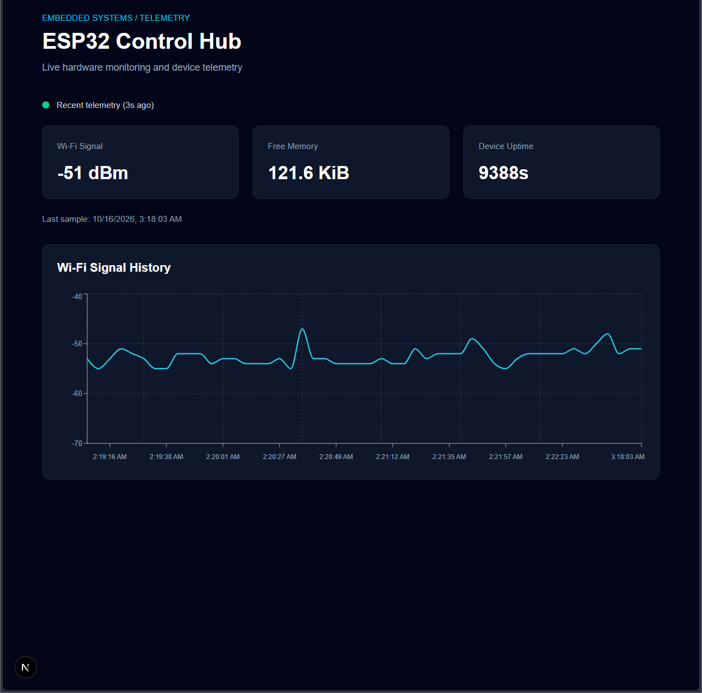

# ESP32 Control Hub

A full-stack IoT project for controlling an ESP32 microcontroller and monitoring real hardware telemetry through a web dashboard.

Built with MicroPython, Python, FastAPI, Next.js, and TypeScript.

## Overview

ESP32 Control Hub connects a physical microcontroller to a web-based monitoring system.

The ESP32 exposes HTTP endpoints for LED control and system telemetry. A Python backend periodically collects device measurements, stores historical data in CSV format, and provides an API consumed by a Next.js dashboard.



## Features

- **LED control:** Turn an external LED on or off and adjust its brightness using PWM.
- **Device telemetry:** Monitor Wi-Fi signal strength, free memory, and uptime.
- **Automatic collection:** Poll the ESP32 approximately every five seconds.
- **Historical data:** Store telemetry measurements in CSV format.
- **Live dashboard:** Automatically refresh measurements without reloading the page.
- **Wi-Fi visualization:** Display historical signal strength using Recharts.
- **Freshness monitoring:** Identify outdated measurements and backend connection errors.
- **Automated testing:** Python tests and frontend TypeScript and ESLint checks.

## Architecture

```text
ESP32 (MicroPython)
        |
        | HTTP / Wi-Fi
        v
Python Telemetry Collector
        |
        v
CSV Telemetry Storage
        |
        v
FastAPI Backend
        |
        v
Next.js Dashboard
```

## Tech Stack

| Component | Technology |
|---|---|
| Microcontroller | ESP32 |
| Firmware | MicroPython |
| Backend | Python, FastAPI |
| Storage | CSV |
| Frontend | Next.js, React, TypeScript |
| Styling | Tailwind CSS |
| Visualization | Recharts |
| Testing | pytest, TypeScript, ESLint |

## Hardware

- ESP32 development board
- Breadboard
- External LED
- 330Ω resistor
- Jumper wires
- USB cable

The external LED is connected to GPIO23 through a current-limiting resistor.

## Getting Started

### Backend

Create a Python virtual environment, install the backend dependencies, and start FastAPI.

```bash
python3 -m venv backend/.venv
backend/.venv/bin/python -m pip install -r backend/requirements.txt

backend/.venv/bin/python -m uvicorn app.main:app \
  --app-dir backend \
  --host 127.0.0.1 \
  --port 8000
```

The backend expects the ESP32 HTTP server to be running on the local network.

Set `ESP32_DEVICE_URL` to your ESP32's address if it differs from the configured default.

### Frontend

```bash
cd frontend
npm ci
npm run dev
```

Open http://localhost:3000.

### Firmware

Flash MicroPython onto a compatible ESP32, configure your Wi-Fi credentials in `src/config.py` on the device, and deploy the firmware modules from `src/`.

The firmware HTTP server must be running for new telemetry measurements to be collected.

## API Endpoints

| Endpoint | Description |
|---|---|
| `GET /api/health` | Backend health |
| `GET /api/telemetry/latest` | Latest stored telemetry |
| `GET /api/telemetry/history` | Historical telemetry measurements |

The ESP32 firmware also exposes endpoints for device status, LED control, and system telemetry.

## Testing

Run backend tests from the project root:

```bash
PYTHONPATH=backend backend/.venv/bin/python -m pytest backend/tests/ -v
```

Run frontend validation from the `frontend/` directory:

```bash
npx tsc --noEmit
npm run lint
```

## Project Status

**v1.0 — Initial functional release**

ESP32 communication, LED control, automatic telemetry collection, historical storage, dashboard visualization, and freshness monitoring are implemented and tested.
